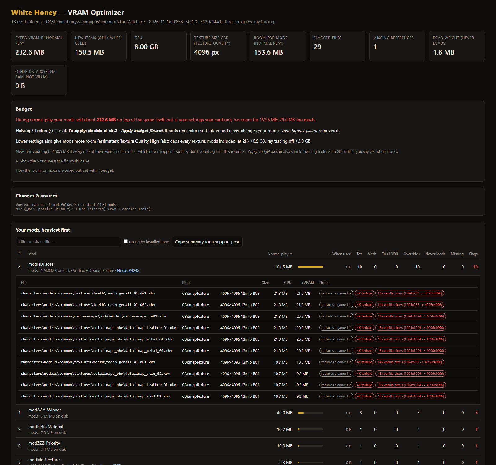
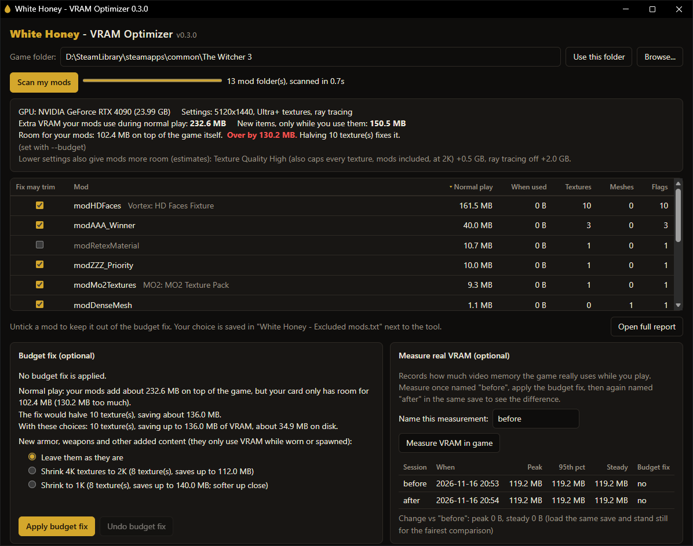
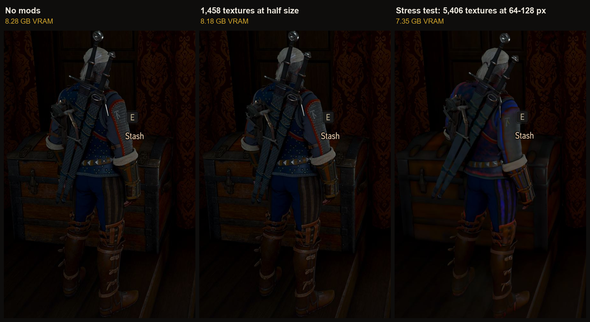

# White Honey - VRAM Optimizer

**Find out which of your Witcher 3 texture and mesh mods are eating your VRAM, fix the worst offenders with one click or one command, and measure the result in-game.**

In the game, White Honey clears the toxicity out of Geralt's blood. This one clears it out of your video memory.

The same idea as [VRAM RipperDoc](https://www.nexusmods.com/cyberpunk2077/mods/36878) for Cyberpunk 2077, rebuilt for REDengine 3. Script Merger shows which mods fight over *scripts*. Nothing showed what *asset* mods (`texture.cache` and `.bundle` files) cost. White Honey scans every mod in your `mods` and `dlc` folders and tells you:

- **Added VRAM per mod:** the GPU data of each texture and mesh, minus what the vanilla file it replaces already used
- **Geometry:** LOD0 triangles, missing LODs, "N× vanilla triangles"
- **Texture problems:** 4K/8K, no mipmaps, uncompressed formats, "16× vanilla pixels"
- **Dead weight:** files that lose a load-order conflict and never load, and files identical to vanilla
- **Problems:** truncated or corrupt `texture.cache` and bundle files, and **missing references** (a mod points at a file that isn't installed, usually a missing requirement)
- **Possibly unused files:** new textures and meshes nothing references
- **Which installed mod each folder belongs to,** read from Vortex or Mod Organizer 2, with a link to its Nexus page

Then it:

- Works out the **room for mods**: how much VRAM your mods can add on top of the game itself, from your GPU and your in-game settings (resolution, texture quality, ray tracing, frame generation, HairWorks). If you're over, it also says which setting changes give the most room.
- Lists which textures to halve to fit that budget, and can **apply the plan** as one separate, removable mod folder (`--make-budget-fix`). You can **keep chosen mods out** of the fix.
- **Measures real VRAM** while you play (`--live`), so you can compare before and after
- Shows **what changed since your last scan**, and gives you a **copy-paste summary** for support threads

The scan is **read-only**. The only thing that ever writes to your game folder is `--make-budget-fix`, which adds one extra mod folder and never modifies your mods. Delete that folder and everything is back as it was.

Works with The Witcher 3 **Remastered (5.x)**, and reads mods cooked for the older Next-Gen (4.x) and Classic (1.3x) versions.

**Download:** [Nexus Mods](https://www.nexusmods.com/witcher3/mods/15760) or [GitHub releases](https://github.com/La2o/Witcher3-WhiteHoney-VRAMOptimizer/releases).



## Install

Extract the zip anywhere, for example into your Witcher 3 folder (the one that contains `bin` and `content`) or onto your Desktop. The tool finds Steam, GOG and Epic installs by itself; if it can't, it asks for the game folder once and remembers it.

Download it manually rather than through a mod manager: it is a tool you run, not a game mod, and installing it through Vortex or Mod Organizer 2 has not been tested.

Requirements: Windows 10/11 x64. No .NET install is needed (both exes are self-contained), and nothing from the game is needed to read its files. The window (`WhiteHoneyUI.exe`) shows its page in Microsoft Edge, which Windows 10 and 11 include; without Edge it uses Chrome or your default browser.

**"WhiteHoney.exe is missing", "is not recognized as an internal or external command", or `WhiteHoneyUI.exe` has disappeared:** your antivirus most likely removed the exe. Restore it from Windows Security > Virus & threat protection > Protection history (*Restore* or *Allow on device*), or download the zip again and unpack all of it.

## Use

There are two ways to use it, and they do the same things: a window, or the numbered shortcuts that run in a console window. Use whichever you like; they share the same reports, the same budget fix and the same list of excluded mods.

### The window

Open the `White Honey` folder and double-click `WhiteHoneyUI.exe`.



- **Game folder:** found by itself for Steam, GOG and Epic. If not, press *Browse...* or paste the folder and press *Use this folder*. It is remembered.
- **Scan my mods:** reads your mods (changes nothing) and fills the list, heaviest first. Click a column header to sort. The summary above the list says how much VRAM your mods add, how much room your card has for mods, and whether they fit.
- **Fix may trim:** one checkbox per mod. Untick a mod to keep it out of the budget fix. The choice is saved at once in `White Honey - Excluded mods.txt`, the same file the shortcuts use.
- **Budget fix:** shows what the fix would do with your current choices (how many textures, the VRAM saving, the size on disk), and whether to leave new armor, weapons and other added content alone or shrink their textures to 2K or 1K. *Apply budget fix* asks once, then writes the one extra mod folder. *Undo budget fix* removes it. If you untick a mod that is already in an applied fix, or update or remove a mod, the panel says the fix is out of date.
- **Open full report:** opens the same `White-Honey-Report.html` the scan shortcut makes.
- **Measure real VRAM:** type a name (for example *before*), press *Measure VRAM in game*, start the game and play; close the game or press *Stop measuring* to finish. The table compares your last measurements.

The window is a page shown in an app-style Microsoft Edge window (Chrome or your default browser if Edge is missing). The page comes from `WhiteHoneyUI.exe` on your own PC, on a local address only this PC can reach (`127.0.0.1`), and nothing is sent anywhere. Close the window and the tool closes a few seconds later. If the window is only in the background while you play, the tool keeps running.

### The shortcuts

Double-click the numbered shortcuts (`START HERE.txt` explains them):

| Shortcut | What it does |
|---|---|
| `1 - Scan my mods.bat` | Scans and opens `White-Honey-Report.html`. Changes nothing. |
| `2 - Apply budget fix.bat` | Lets you pick mods to leave untouched, asks first, then writes the one extra budget fix folder. |
| `3 - Measure VRAM in game.bat` | Asks for a name (for example *before* or *after*), then records real VRAM until you close the game. |
| `Undo budget fix.bat` | Removes the budget fix wherever it was saved: the game's `mods` folder or the MO2 mod "White Honey Budget Fix". |

Everything is also available from the command line:

```
 Scan (default, read-only)
  --game <dir>              The Witcher 3 folder (auto-detected for Steam/GOG/Epic, or when run from inside it)
  --budget <GB>             VRAM your mods may add (default: from your GPU and in-game settings)
  --vram <GB> [--gpu <name>]  Your graphics card's VRAM (default: detected)
  --settings <file>         The game's dx12user.settings or user.settings (default: detected)
  --mods-settings <file>    The game's mods.settings with load order priorities (default: detected)
  --out <dir>               Where to write reports (default: next to the exe)
  --mo2 <instance dir>      Read mods from a Mod Organizer 2 instance (auto-detected when possible)
  --top <n>                 Rows to show in the console (default 25)
  --no-vanilla              Skip comparing against the base game files (faster, less accurate)
  --no-open                 Don't open the HTML report when done
  --json                    Print the JSON report to stdout instead of the table
 Apply the plan (optional)
  --make-budget-fix         Write ONE extra mod folder with the planned textures halved (your mods are untouched)
  --include-new-items       Also shrink new armor, weapons and other added content to 2K
  --new-items-to 1k         ... to 1K instead
  --exclude "<mod>;<mod>"   Never shrink these mods, for this run only
  --exclude-file <file>     Use a different list of excluded mods (default: White Honey - Excluded mods.txt)
  --remove-budget-fix       Delete it again
 Measure real VRAM
  --live [--label <name>] [--seconds <n>]   Record the game's actual VRAM use while you play (Ctrl+C to stop)
```

### A typical session

The steps below use the shortcuts; the buttons in the window do the same.

1. Run `1 - Scan my mods`. Check the report: the top rows are your heaviest mods, and the red counts are flags worth reading.
2. Load a save and stand somewhere busy, then run `3 - Measure VRAM in game` and name it *before*. Play a minute and close the game.
3. Run `2 - Apply budget fix`.
4. Load the same save and measure again as *after*. The monitor prints a before/after table.
5. Don't like it? Run `Undo budget fix`.

### Keeping mods out of the fix

In the window, untick the mod's *Fix may trim* checkbox. With the shortcuts, `2 - Apply budget fix` first shows a numbered list of the mods the fix would touch, with how many textures and how much VRAM each. Type the numbers of the mods to leave untouched (for example `1,3`), or press Enter to trim them all. It then asks whether to remember your choice for next time.

Remembered choices are kept in `White Honey - Excluded mods.txt` next to the tool. The first scan creates it, with instructions inside. Put one mod per line: its folder name in the game's `mods` folder (for example `modHDReworkedProject`) or its name in Vortex or Mod Organizer 2. A `*` matches anything (`mod*Geralt*`), and lines starting with `#` are notes. Edit it in Notepad whenever you like.

Textures of an excluded mod are never shrunk. The scan and the report list them as "kept as is", and say so if the mods can't fit the budget any more because of them. If a fix is already applied and you exclude a mod afterwards, the next scan says the fix is out of date. Run `2 - Apply budget fix` again to rebuild it without that mod.

### Reading the report

| Column | Meaning |
|---|---|
| **Normal play** | Extra GPU memory during normal play: files that replace game files, plus new files those replaced files point to. This is what the budget is compared against. Negative means lighter than vanilla. |
| **When used** | New armor, weapons, hair and other added content (including DLC-style mods). They only take VRAM while worn or spawned, so this total never loads at once and is not counted against the budget. |
| **Tex / Mesh** | Texture and mesh counts in the mod |
| **Tris LOD0** | Triangles at full detail, summed over meshes that actually load |
| **Overrides** | Files that replace a vanilla file |
| **Never loads** | Files another mod wins in load order (pure dead weight) |
| **Missing** | Hard references to files that exist nowhere: in vanilla or in any installed mod |
| **Flags** | Files with a warning (click the row to see them) |

"Group by installed mod" adds up all folders of one Vortex/MO2 mod. "Copy summary" puts a short Markdown table on your clipboard for Nexus, Reddit or Discord.

## How the budget fix works

A Witcher 3 texture mod keeps its big mip levels in `texture.cache`, one zlib block per mip. For each planned texture, White Honey copies the texture's entry **without its largest mip** into a new cache. The mips that remain are the mod's own smaller versions, copied byte for byte, so nothing is decoded or re-encoded and the result is exactly what the game would show for that texture from a bit further away. Mods you excluded are skipped. If an excluded mod loses a file conflict to another mod, that texture belongs to the winning mod and can still be trimmed there.

The new cache goes into its own mod folder, `mods\mod0000_WhiteHoneyFix\content\texture.cache`. The folder name is chosen so it loads before your mods (more zeros are added if a mod of yours sorts earlier), and if you use a `mods.settings` load order file the fix is added to it with the best priority (with a backup).

Next to the cache is a small list (`white_honey_fix.json`; the game ignores it) of each texture the fix replaces and a fingerprint of the mod copy it came from. Every scan compares that list with your installed mods and warns when the fix is out of date: a mod was updated (the fix would show the old texture) or removed (the fix would bring its texture back).

### Tested in game (The Witcher 3 Remastered 5.01c, Steam build 26238013, RTX 4090, 5120x1440, Ultra+ textures, ray tracing on)

All three runs loaded the same save and stood in the same room; VRAM is the steady value over the last 60 s.

| Run | What was installed | Game VRAM |
|---|---|---|
| Baseline | No mods | **8.28 GB** |
| Half size | A fix-style cache with 1,458 of the game's own 2K+ textures (Geralt, items, decorations) halved once | **8.18 GB**, looks the same at normal distance |
| Extreme | Every 2K+ texture in the game (5,406) cut to 64-128 px | **7.35 GB**, armor and props visibly low-res, colors and shapes correct |



- The game started, loaded the save and rendered correctly each time, with no crashes or missing textures. The extreme run proves the game really takes its textures from a cache this tool wrote, from a mod folder that holds nothing but `texture.cache`.
- How much you save depends on what is on screen: only part of those textures was visible in that room. A heavy texture modlist saves more, which is why `3 - Measure VRAM in game` is there.
- The save files were byte-identical after the tests.
- Not tested yet: a fix built from a real Nexus texture mod made for game 4.x or older (cache version 6, old bundle layout). Those files are read by the same code with the published layout, but no such mod was at hand to check against.

### The window: what was tested (0.3.0)

On Windows 11 with Microsoft Edge, on the test mods that `--make-fixtures` builds (the game on the test PC has no mods installed):

- Scan, sorting, and the summary: same numbers as the console tool.
- Unticking and ticking a mod: the plan changes and `White Honey - Excluded mods.txt` is updated at once.
- Apply (with its Yes/No question; No writes nothing) and Undo: the fix folder and its `mods.settings` entry are written and removed, and the fix is byte for byte the one the console tool writes for the same plan.
- The out-of-date warning after unticking a mod that is in the applied fix.
- Open full report, the folder picker, a wrong game folder, and closing the window (the tool quits about 4 seconds later).
- Measuring: started, stopped and compared in the window, but against another running program standing in for the game.

Not tested yet in the window: a real modlist, measuring with the game itself running, the Mod Organizer 2 question and saving the fix as an MO2 mod, running without Edge (Chrome or default browser), and Windows 10.

## How the scan works

1. Reads the game's load order: folders in `mods` whose name starts with `mod`, by `mods.settings` priority where set, then by name (the first mod wins a conflict). Then DLC-style mods in `dlc`, Steam Workshop subscriptions, and MO2 mods that live outside the game folder.
2. **Textures:** reads the index at the end of each `texture.cache` (size, mips, slices, bytes). The uncompressed size of the mips is the GPU footprint. A texture replaces a vanilla one when the game's own caches have the same key. Your Texture Quality setting is applied first: Low never shows more than 1K, Medium and High 2K, Ultra and Ultra+ 4K, so a 4K mod texture on High counts (and is planned) as the 2K the game really loads.
3. **Meshes:** reads every file in the mod's bundles (old 4.x and new 5.x bundle layouts, zlib/LZ4/Snappy). For meshes it reads the cooked render data: vertex and index buffer sizes, triangles per LOD and the LOD list.
4. Indexes the vanilla bundles and texture caches to compute the delta for overrides, compare with vanilla resolution and triangles, spot identical copies, and tell which references the mod *added*. That last part means vanilla's own dead links never count as missing.
5. Follows references (import tables, item definition XML, scripts) to tell new files that load in normal play from new items that only load when used.

Validation on real game data (Remastered 5.01c):
- 25,486 textures split into mips and inflated, all of them readable.
- 620 textures shrunk, written to a new cache, read back and compared byte for byte with the source's smaller mips: 620 identical.
- 252,803 bundle files read with 0 failures; 56,474 meshes parsed.
- 3 "missing reference" hits across 1.4 million vanilla references, all in world files that mods don't replace (and only references a mod *adds* are ever reported).

## Honest limits

- **Estimates, not live usage.** The game streams textures into a pool whose size your Texture Quality setting picks (`TextureMemoryBudget`, 1200 MB on Ultra), so a 4K texture you never get close to costs less in practice, and a modlist that wants far more than the pool can show up as textures that stay blurry rather than as stutter. The numbers are an upper bound for "everything this mod adds is on screen at full size". Measure before and after any change.
- **Biggest win on 6-12 GB cards** with heavy texture packs, especially with ray tracing on. If you aren't VRAM-limited you won't gain FPS.
- **Load order with `mods.settings`:** the tool assumes mods without a Priority load after the ones that have one (as mod managers show it). Without that file, order is by folder name, as the game's own documentation says.
- **The budget fix halves textures; it doesn't touch meshes.** Dense meshes are flagged for you to swap or remove.
- Mods installed through the in-game Mods menu (mod.io) are not scanned yet. Mods in the `mods` and `dlc` folders, Steam Workshop subscriptions, Vortex and MO2 are.
- The "room for mods" figure uses a rule of thumb for what the game itself needs, checked against one real measurement (8.3 GB at 5120x1440, Ultra+, ray tracing). Your own measurement beats it.

## Build

```
dotnet publish src/WhiteHoney -c Release -o dist/bin
dotnet publish src/WhiteHoneyUI -c Release -o dist/bin-ui
```

Or run `build.ps1` to also make the Nexus/Vortex-ready zip.

`src/WhiteHoney` is the console tool and the engine. `src/WhiteHoneyUI` is the window: it compiles the same engine files (everything but the console `Program.cs`), serves one HTML page (`index.html`) from a small HTTP server bound to `127.0.0.1`, and opens it in an app-style browser window. Every request must carry a random token made at start, so other web pages can't drive the tool. The version number lives in `src/WhiteHoney/WhiteHoney.csproj` for both.

Developer self-tests:
- `--make-fixtures <dir>` builds fake mods from real game files: a heavy retexture, conflicts, mods.settings priorities, new items, a broken reference, corrupt files, Vortex and MO2. Scan them with `--mod-root <dir> --mo2 <dir>\_mo2` (`WhiteHoneyUI.exe` takes the same two options, so the window can be tried on them without touching the game).
- `--verify-cache <texture.cache>` checks that textures split into mips as expected and every block inflates.
- `--verify-shrink <texture.cache>` shrinks textures, writes them to a new cache and compares them with the source's smaller mips.
- `--vanilla-check` runs the bundle, mesh and reference readers over the game's own files.

## License

MIT. Not affiliated with CD PROJEKT RED. The Witcher is a trademark of CD PROJEKT S.A.
